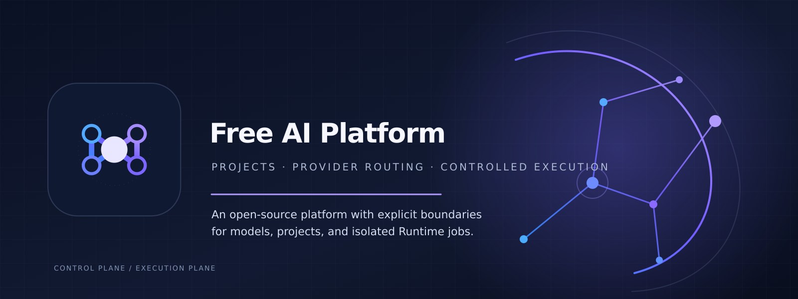
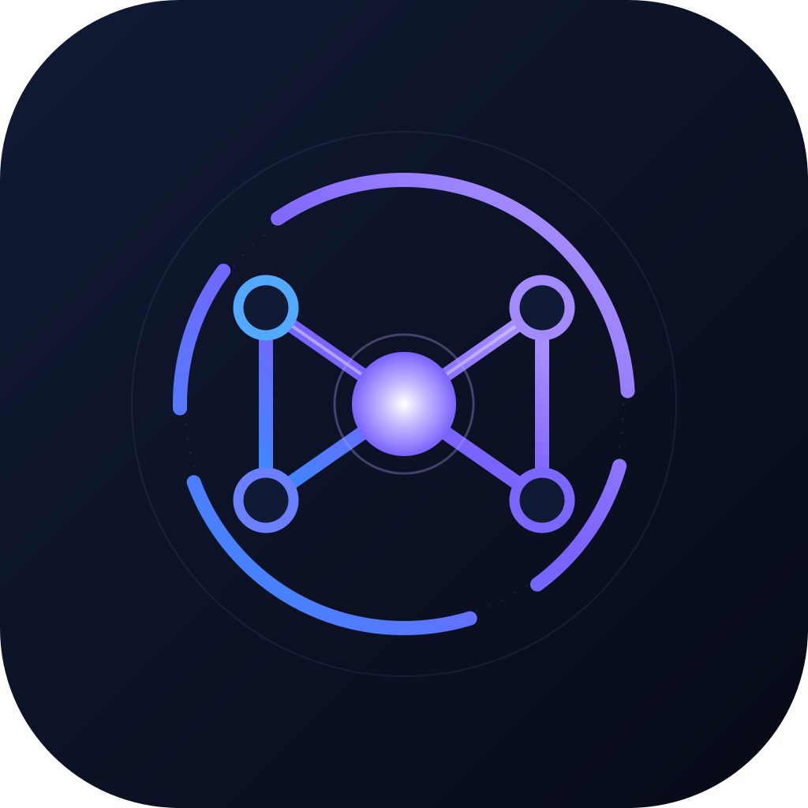
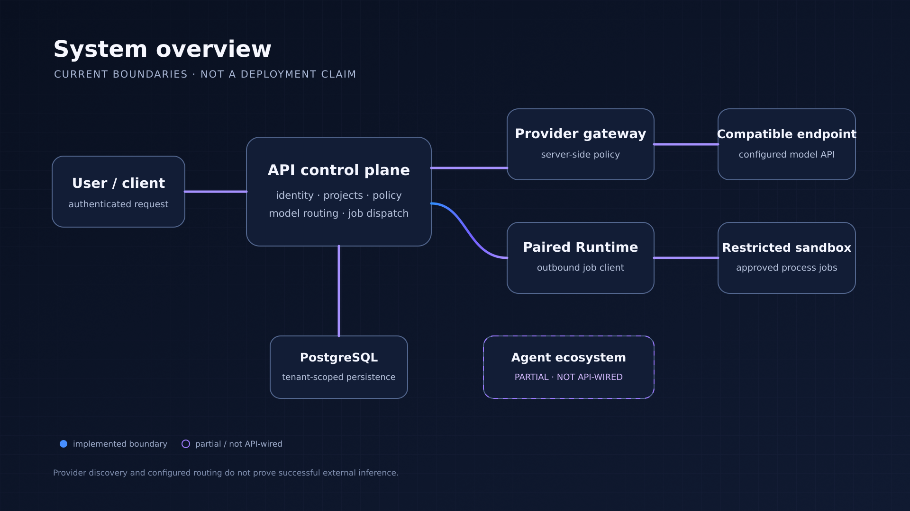
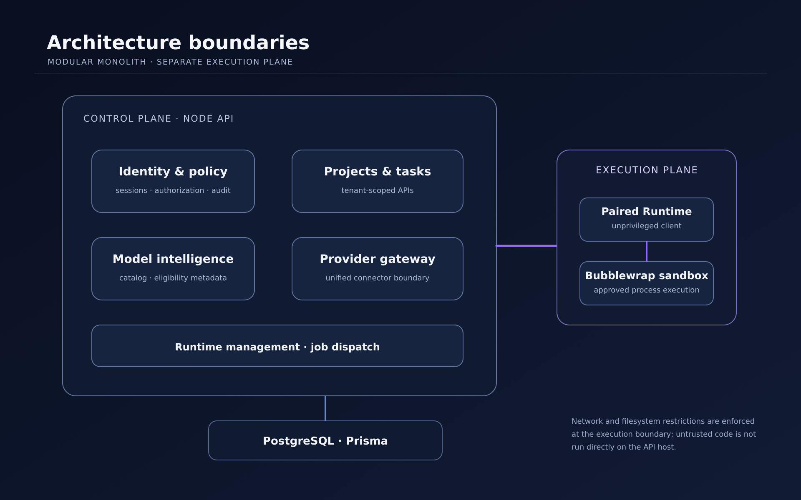
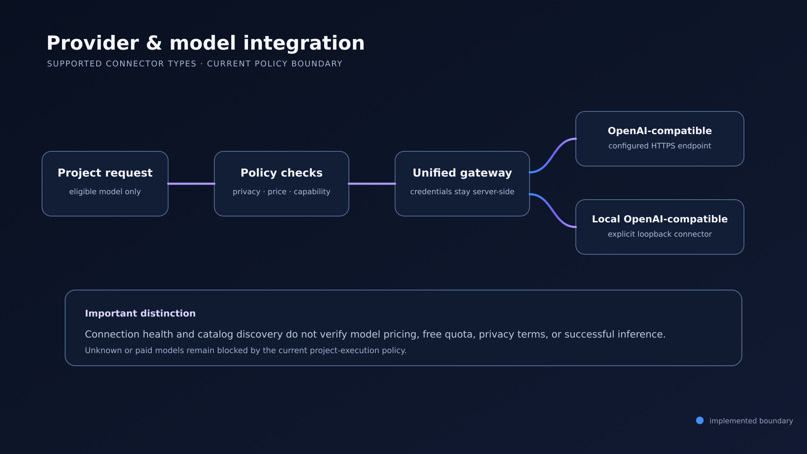
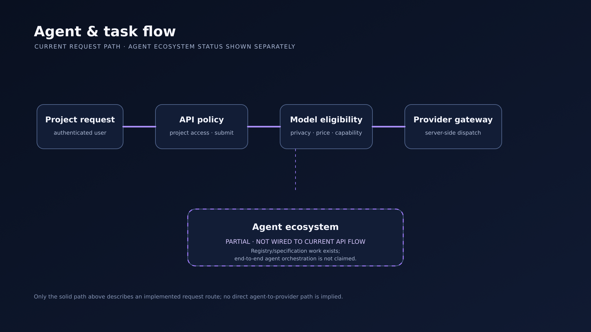

<p align="center">
  
</p>

<p align="center">
  
</p>

<h1 align="center">Free AI Platform</h1>

<p align="center">
  An open-source, self-hosted control plane for AI projects, provider routing, and restricted task execution.
</p>

<p align="center">
  <a href="https://github.com/online-life/free-ai-platform/actions/workflows/ci.yml">
    
  </a>
  <a href="https://github.com/online-life/free-ai-platform/blob/main/LICENSE">
    
  </a>
  
</p>

> **Project status: NOT PRODUCTION READY.** Production deployment, live-provider
> inference, and authenticated full-browser acceptance remain unverified. Read
> [current status](docs/STATUS.md) before evaluating deployment or release
> readiness.

**Explore:** [Overview](#overview) · [Capabilities](#project-capabilities) ·
[Architecture](#architecture) · [Providers](#providers-and-models) ·
[Installation](#installation) · [Documentation](docs/README.md) ·
[Contributing](CONTRIBUTING.md)

## Overview

Free AI Platform is a self-hostable application for managing AI projects,
provider and model records, project-scoped requests, and controlled Runtime
jobs through a central API. It combines a Node.js/TypeScript API, a web
console, PostgreSQL persistence, and a separately bounded Runtime service.

**Vision:** make AI-assisted project work inspectable and governable from one
place. **Mission:** build that control plane around explicit authorization,
provider policy, and execution boundaries, while clearly separating working
features from unfinished plans.

## Project capabilities

| Status | Capability |
| --- | --- |
| **Available** | Owner bootstrap, server-side browser sessions, tenant/project APIs, and permission-checked project access. |
| **Available** | Provider/model administration and central routing through generic OpenAI-compatible or loopback-only local OpenAI-compatible connectors. |
| **Available** | Paired Runtime management and dispatch of approved work into restricted execution boundaries. |
| **Partial / not verified** | Project requests are covered with a mock provider; successful live external inference and authenticated full-browser administration acceptance are not verified. |
| **In progress** | Agent and workflow capabilities are incomplete. Production service lifecycle, deployment hardening, and recovery are not complete. |

These labels describe the current implementation, not a production-readiness
claim. See [status and evidence](docs/STATUS.md) and the [roadmap](docs/ROADMAP.md).

## Architecture

The API is the control plane for identity, authorization, project policy,
provider routing, and Runtime coordination. PostgreSQL stores application
state. Paired Runtime services execute approved work within restricted
boundaries. These diagrams describe current code-level boundaries, not a
production deployment guarantee.

<p align="center">
  
</p>

<details>
  <summary>Detailed platform architecture</summary>
  <p align="center">
    
  </p>
</details>

## Providers and models

The current adapter registry supports two connector identities:
`OPENAI_COMPATIBLE` for remote HTTPS endpoints and
`LOCAL_OPENAI_COMPATIBLE` for explicitly configured loopback endpoints. These
are protocol-compatible connectors, not dedicated provider-brand integrations.
There is no dedicated OpenCode or FreeLLMAPI integration in the current code.

The project request form selects only enabled, available, privacy-approved
text-generation models classified as verified-free or self-hosted. Provider
health or catalog discovery does not prove that inference works or that a
model's pricing and data handling are suitable. The form sets fallback count
to zero. API callers may request up to two fallback attempts for retryable
provider errors, subject to the model/provider constraints they selected.

<p align="center">
  
</p>

Details: [provider setup and project requests](docs/13-operations/provider-setup-and-execution.md).

## Agents and workflows

Agent definitions and workflow-related components exist, but end-to-end agent
orchestration is not wired into the current request flow. The project does not
claim a complete autonomous agent system.

<p align="center">
  
</p>

## Developer experience

- The running API exposes its OpenAPI document at `/api/v1/openapi.json`.
- Shared contracts and TypeScript packages support the API and Runtime.
- CI validates Prisma, API and web types/builds, and Vitest on pushes to `main`
  and pull requests.
- The web console serves locally on `http://127.0.0.1:4173`; the API defaults
  to `http://127.0.0.1:3000`.

The repository does not include verified product screenshots. The images above
are original diagrams, not screenshots or claims of completed UI acceptance.

## Technology stack

| Area | Technologies |
| --- | --- |
| API and Runtime | Node.js 22+, TypeScript |
| Web | Static web client served by Node.js |
| Persistence | PostgreSQL, Prisma |
| Contracts and validation | TypeScript, Zod |
| Workspace | pnpm 9 |
| Verification | Vitest, Node.js test runner, PostgreSQL-backed E2E suites |

## Installation

Requirements are Node.js 22+, pnpm 9.12.0, and PostgreSQL. Linux plus
Bubblewrap and `prlimit` are required for Runtime sandboxed process execution.
No minimum PostgreSQL version or supported OS matrix is declared, and Docker
installation is not currently provided. Follow the detailed
[installation and first-run guide](docs/getting-started/installation.md) for
database role setup, environment variables, migrations, startup, and
troubleshooting.

## Quick start

After configuring a disposable local database and the required environment:

```bash
bash scripts/install-local.sh
```

The installer applies migrations and builds the services; it does not start
them or complete owner bootstrap. Node services do not automatically load
`.env`; load the configured values into each service process as described in
the installation guide. Start the API and web client in separate terminals:

```bash
pnpm api:start
```

```bash
pnpm web:dev
```

Complete the one-time owner bootstrap, then sign in and change the temporary
password. Public self-registration is disabled. See the
[first-run owner setup](docs/03-specifications/layer-01-platform-core/first-run-owner-setup.md)
for the credential lifecycle and the
[user guide](docs/user-guide/README.md) for verified user flows.

## Usage example

After signing in, create a project, configure an eligible provider/model, and
submit a request from **Run a project request**. Review the returned response
and routing information. The project request path is covered by a
mock-provider E2E test; successful live external inference has not been
verified. Agent definitions and project workflows are documented in the
[user guide](docs/user-guide/README.md#agents) with their current execution
limits.

## Configuration

The application requires a PostgreSQL connection and a 32-byte base64
`SECRETS_MASTER_KEY` for provider credential encryption. The installer
requires `BOOTSTRAP_TOKEN` and the API uses it only for first-owner bootstrap.
Keep real credentials out of version control, shell history, screenshots, and
logs. See [installation](docs/getting-started/installation.md),
[backup and restore](docs/13-operations/installation-backup-restore.md), and
[security guidance](docs/SECURITY.md) for supported configuration.

## Testing

Useful local checks:

```bash
pnpm prisma:validate
pnpm typecheck
pnpm web:typecheck
pnpm api:build
pnpm web:build
pnpm exec vitest run
```

Database-backed E2E tests require an explicitly disposable PostgreSQL
database, and some suites require different database-role attributes. Read the
[testing strategy](docs/12-testing/testing-strategy.md) before running them.
CI does not represent live-provider or production-deployment acceptance.

## Documentation

Start at the [documentation index](docs/README.md) for
[Getting Started](docs/getting-started/installation.md),
[User Guide](docs/user-guide/README.md),
[Developer Guide](docs/developer-guide/README.md),
[Architecture](docs/ARCHITECTURE.md),
[API and contracts](docs/README.md#api-and-contracts),
[Integrations](docs/13-operations/provider-setup-and-execution.md),
[Deployment and operations](docs/13-operations/installation-backup-restore.md),
[Security](SECURITY.md), [Contributing](CONTRIBUTING.md), and
[Roadmap](docs/ROADMAP.md).

## Roadmap

Current work includes completing production service and deployment lifecycle,
authenticated browser acceptance, and deeper agent/workflow integration. See
the [roadmap](docs/ROADMAP.md) and [current status](docs/STATUS.md); items in
specifications or historical reports are not necessarily implemented.

## Contributing

Read [CONTRIBUTING.md](CONTRIBUTING.md), the
[development guide](docs/DEVELOPMENT.md), and the
[Code of Conduct](CODE_OF_CONDUCT.md) before opening a change. Keep changes
focused, preserve security boundaries, and include relevant test evidence.

## Security

Do not disclose vulnerabilities, credentials, or private infrastructure
details in public issues. Follow the [security policy](SECURITY.md) and
[security implementation guidance](docs/SECURITY.md).

## License

Free AI Platform is licensed under the [Apache License 2.0](LICENSE).

## Credits and attribution

See [NOTICE](NOTICE) and the
[project status and publication review](docs/STATUS.md). The provenance/license
review of some pre-existing SVG and skill-catalog material remains unresolved;
do not assume that those items are cleared for reuse.

## Contact and support

Use [GitHub Issues](https://github.com/online-life/free-ai-platform/issues) for
reproducible bugs and scoped feature requests. For security concerns, follow
the [security policy](SECURITY.md) and do not post sensitive details publicly.
